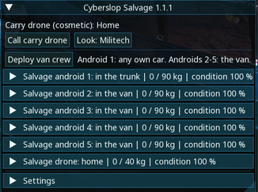
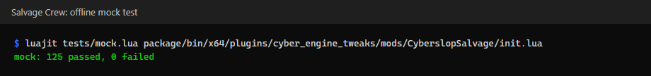

# Cyberslop Salvage

Salvage androids and a salvage drone that collect loot from downed enemies after a fight, for Cyberpunk 2077. Single-player only.
Version 1.1.1 | For game version 2.5 | Status: runs in game (the mod's own log shows deploying, looting, standby and service); no written test pass yet, see Status

> This is an unofficial fan work and is not approved/endorsed by CD PROJEKT RED. No game files are included.

## The problem

After a large fight, looting every body by hand is a chore, and the companion-drone mod used before did far more than was needed here. The goal was a helper that does one job and costs almost nothing when idle.

## What I built

A Cyber Engine Tweaks script (1,578 lines of Lua) and a redscript system (894 lines). It adds: up to five salvage androids, one flying salvage drone and a cosmetic carry drone. The salvage units walk or fly to downed enemies once combat is over, take the loot into their own cargo, and wire you any cash they find. It changes: which items remain on downed enemies, and it stores its own cargo ledger in the save. No game function is hooked.

## How it works

- At start the script creates its own character records by cloning vanilla android and drone records: five times the health, no weapons, senses off, so enemies ignore them.
- A 1 Hz tick drives the units with simple orders. A 20 Hz step runs only while a drone is flying a leg. There are no Observe or Override hooks.
- Cargo, trip timers, wear and field state live in a persistent redscript system, so they are saved with the game and a reload cannot duplicate loot.
- Capacity: 90 kg per android, 40 kg for the drone. The window lists cargo by category with "Take" buttons, which work when the unit is within 6 m.
- "Sell all" or "Recycle all" sends a unit away for a trip (default 120 game minutes) and pays on return (default 80 % of vendor price) or returns crafting components.
- Units wear: 2 % per active game hour, 0.5 % per hour on standby, 0.5 % per body searched. Service costs crafting components; missing ones are bought.
- Android 1 deploys from the trunk of any car you own; androids 2 to 5 need one specific van.

```text
package/
  bin/x64/plugins/cyber_engine_tweaks/mods/CyberslopSalvage/init.lua
  r6/scripts/CyberslopSalvage/CyberslopSalvage.reds
tests/mock.lua    runs the Lua against a stubbed game API (125 checks)
```

## Requirements

| Requirement | Version | Link |
|---|---|---|
| Cyberpunk 2077 | 2.5 | |
| Cyber Engine Tweaks | a build for 2.5 | [Nexus Mods, mod 107](https://www.nexusmods.com/cyberpunk2077/mods/107) |
| redscript | a build for 2.5 | [Nexus Mods, mod 1511](https://www.nexusmods.com/cyberpunk2077/mods/1511) |

No other mod is needed. Requirements are not bundled.

## Install

1. Install the requirements above.
2. Copy the contents of `package/` into the game folder.
3. Start the game, load a save, open the CET overlay and find the "Cyberslop Salvage" window. Stand next to a car you own and press "Deploy" for android 1.

## Uninstall / roll back

1. Take everything out of the units' cargo first: cargo still aboard is lost when the mod is removed.
2. Close the game.
3. Delete `bin\x64\plugins\cyber_engine_tweaks\mods\CyberslopSalvage` and `r6\scripts\CyberslopSalvage`.
4. Saves keep working. The mod's stored data is dropped the next time the game saves.

## Configuration

In the window, saved to `config.json` in the mod's folder:

| Option | Default | Range |
|---|---|---|
| Auto-loot downed enemies (out of combat) | on | |
| Trip (game minutes) | 120 | 30 to 240 |
| Fence pays (% of vendor price) | 80 | 50 to 100 |
| Log to `CyberslopSalvage.log` | on | |
| Appearance per unit | first | |

Five hotkeys can be bound in CET's Bindings tab, all unbound by default: carry drone call / send to stash; salvage android 1 deploy / send home; salvage drone deploy / send home; van androids 2-5 deploy all / send home; all salvage units standby / resume.

## Status

| What | Result |
|---|---|
| In game, 2.5 | The mod's log from play sessions shows units deployed from a car, bodies looted, cash wired, standby, return and service. |
| Written test pass | None yet. The test list for 1.1.x (five androids, van crew, standby, wear and service) has not been worked through and signed off. |
| Mock test | 125 of 125 checks pass on 1.1.1 with LuaJIT. The test was adjusted for 1.1.1's rule that "Take" needs the unit within 6 m: the stub world now places the unit next to the player before taking. |
| Compile | redscript compiles with 0 errors. |

## Compatibility

| Item | Status | Notes |
|---|---|---|
| Other companion mods | not tested together | Units are spawned through the game's companion system. |
| Mods that change crafting component prices | works | Missing service components are bought at whatever the price record says. |

## Known issues

- The log is on by default, has no size limit and grows by one line per event.
- A save loaded so quickly that the mod's 1-second check never sees the loading screen is not noticed; units then show as waiting. "Send home" clears it.
- Service does not verify that the game really removed the components it charged.
- Not confirmed: whether a unit's body comes back after a load, and whether the search for parked own cars always finds them.

## Engineering notes

**How the problem was found.** Version 1.1.0 was reviewed before its first launch, with the mock test as the tool. With several units out, the review found that a unit whose cargo was full went back to work whenever any unit's cargo changed. It kept walking to the same body, reported "full" again, and gained 0.5 % wear per visit.

**Cause.** The "something changed, look again" signal was one shared counter for all units, while the decision needed the unit's own cargo.

**Fix.** A full unit now waits until its own cargo weight goes down. The mock test was extended with that scenario. This was found by review and reproduced in the mock; it was never seen in the game, because the fix went in before the first launch.

**Other fixes from the same review.** The list of already-looted bodies survived a load, so enemies killed again after a reload were skipped; it is cleared on load now. A unit sent on a trip counted as "in the field" until it had walked off, so a save in that window stored it as both away and out; the trip now takes it out of the field at once.

**Rollback.** Each version was installed by a script that kept the previous files and had a revert switch. For a user: delete two folders.

## Media





## Changelog

See [CHANGELOG.md](CHANGELOG.md). Latest: 1.1.1 (2026-11-23): "Take" only with the unit within 6 m.

## Credits and licence

Runs on Cyber Engine Tweaks and redscript, which are not included here.

MIT, see [LICENSE](LICENSE). The licence covers my code only. Game names and trademarks belong to their owners.

Built with AI assistance (Claude); designed, tested and maintained by me.
